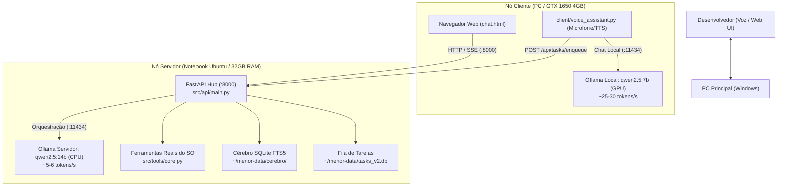

# 01 — Arquitetura e Comunicação entre Nós

O Menor v2 foi desenhado para maximizar a performance combinando o melhor do hardware do desenvolvedor:

## Divisão de Responsabilidades

1. **Nó Servidor (Notebook Ubuntu):**
   * Roda ininterruptamente via systemd (`menor-api.service`).
   * Mantém o estado da memória e projetos em disco.
   * Executa comandos e scripts de terminal solicitados pelos agentes.
   * Utiliza `qwen2.5:14b` para raciocínio profundo, quebra de tarefas e documentação.

2. **Nó Cliente (PC Windows):**
   * Interface de uso imediato: o usuário acessa `http://<IP-DO-NOTEBOOK>:8000` pelo navegador do PC.
   * Pode alternar instantaneamente entre a inferência pesada no notebook ou a inferência ultra-rápida na GPU local usando o seletor da UI.
