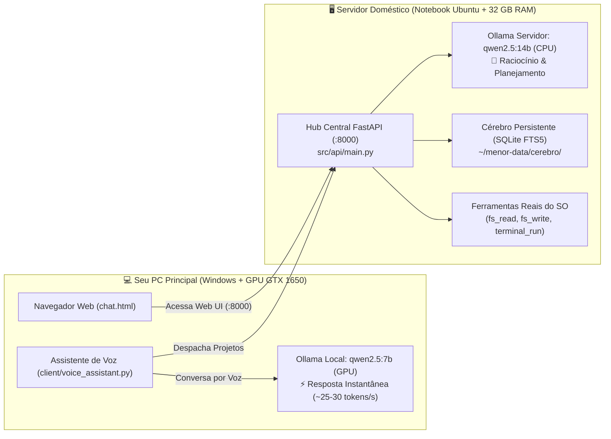

# Menor v2 — Assistente Pessoal & Executivo de Software Local

O **Menor v2** é um assistente de inteligência artificial pessoal e distribuído, projetado para desenvolvedores. Ele une a capacidade de planejamento e raciocínio profundo de um servidor local à velocidade instantânea de interação por voz e chat no seu computador principal.

---

## 🏗️ Arquitetura Distribuída

O Menor v2 opera combinando duas máquinas em sua rede local:



---

## ✨ Principais Capacidades

* **Ferramentas Reais do Sistema:** Lê e cria arquivos reais no disco (`fs_read`, `fs_write`), lista diretórios e executa comandos reais no terminal (`terminal_run`) para rodar linters, suítes de teste e builds.
* **Cérebro Permanente (SQLite FTS5):** Guarda suas preferências de código, notas e decisões de projetos em `~/menor-data/cerebro/` sem depender de vetores pesados.
* **Seletor de Cérebro Dinâmico na Web:** Alterne com 1 clique na interface web entre o modelo de 14B no notebook (para arquitetura e planejamento profundo) e o modelo de 7B na sua GPU local (para respostas em milissegundos).
* **Esteira de Autonomia:** Despacho de tarefas em segundo plano onde o modelo arquiteto quebra o objetivo em etapas, o modelo dev gera o código e o QA executa os testes unitários.
* **Contexto Pronto para IAs:** Documentação completa na pasta `.agents/context/` para que qualquer ferramenta de IA (Cursor, Antigravity, Aider) entenda o repositório instantaneamente.

---

## 🚀 Como Iniciar

### 1. No Servidor (Notebook Ubuntu)
Requer Python 3.10+ e Ollama com `qwen2.5:14b`:

```bash
# 1. Instalar dependências
python3 -m venv .venv
source .venv/bin/activate
pip install -r requirements.txt

# 2. Iniciar o servidor FastAPI
python3 -m uvicorn src.api.main:app --host 0.0.0.0 --port 8000
```
O serviço estará acessível em `http://IP_DO_SERVIDOR:8000`.

### 2. No PC Principal (Windows)
Acesse a interface pelo navegador em `http://IP_DO_SERVIDOR:8000` ou execute o cliente interativo de voz:

```powershell
python -m venv .venv
.venv\Scripts\activate
pip install -r client/requirements.txt
python client/voice_assistant.py --server http://IP_DO_SERVIDOR:8000
```

---

## 🧪 Verificação e Testes

Para rodar a suíte de testes unitários:

```bash
python3 -m unittest discover -s tests -v
```

---

## 📚 Documentação para Agentes de Código

Se você é um agente de IA trabalhando neste repositório, consulte primeiro [`AGENTS.md`](AGENTS.md) e a pasta [`.agents/context/`](.agents/context/).
