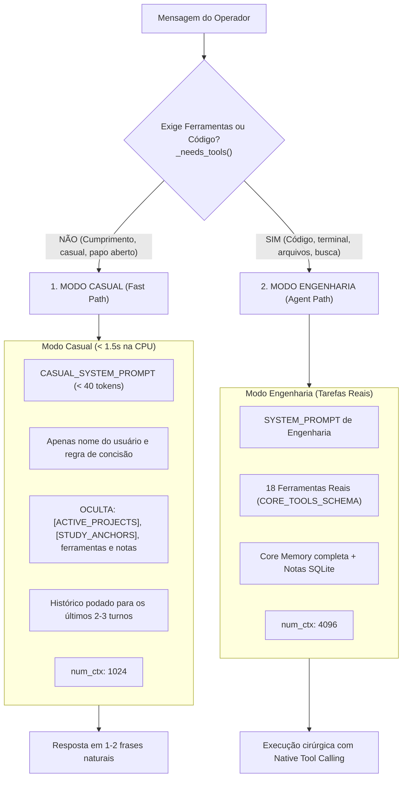
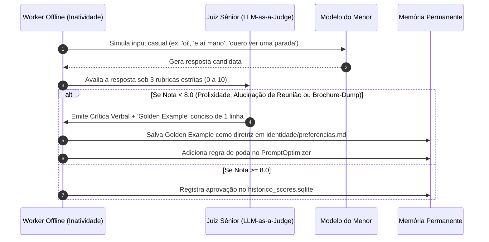

# Plano de Engenharia: Blindagem Cognitiva, Fim do Brochure-Dumping e Auto-Avaliação Contínua

Este documento detalha o diagnóstico dos incidentes reais observados em produção no **Menor v2**, a arquitetura de **Fast Path vs. Heavy Path** e a especificação da esteira de **Auto-Avaliação e Auto-Cura Offline** para ser integrada aos workers de background (`ReflectionWorker` e `DiagnosticEngine`).

---

## 1. Diagnóstico dos Incidentes em Produção

Nas versões anteriores, três interações simples do operador geraram comportamentos disfuncionais e latências inaceitáveis:

| Input do Usuário | Tempo de Espera | Resposta Anômala Gerada | Causa Raiz Técnica |
| :--- | :--- | :--- | :--- |
| `"opa eai"` | **139.5s** | *(Travamento na CPU)* | **Prompt Bloat:** Ingestão de ~2.500 tokens de contexto técnico para uma saudação simples. Em CPU de notebook (prefill a ~15-25 tok/s), o processador leva > 120s só para ler o prompt. |
| `"oi"` | **138.2s** | *"O Menor v2 tá no ar e pronto pra te ajudar com o projeto do cérebro SOTA hoje (Core Memory Letta, Mem0...). Tá com pressa ou quer dar uma leve na máquina antes da reunião? 🤖"* | **Attention Bias + Alucinação Corporativa:** O modelo foi contaminado pelo bloco `[ACTIVE_PROJECTS]` e cuspiu os nomes das ferramentas. Além disso, a persona "assistente executivo" o fez inventar uma reunião de trabalho fictícia. |
| `"cara eu to querendo uma parada"` | **~80s** | *"E aí, Isaac! 'Parada' do que? Se tá com bug na arquitetura do cérebro SOTA, quer ajustar os agentes ou precisa de um script pro worker de reflexão? ... O que tá travado agora? 🛠️"* | **Over-Conditioning:** Ao receber uma frase coloquial aberta, o modelo forçou o assunto para os termos de engenharia que estavam presentes no prompt, assumindo que qualquer "parada" era um bug no sistema. |

---

## 2. A Solução Arquitetural de 2 Vias (Fast Path vs Heavy Path)

Para garantir **respostas em < 1.5s na CPU** e eliminar o comportamento prolixo, o orquestrador divide a inferência em dois modos estritos:



### Regras do Fast Path:
1. **Espelhamento de Energia (Turn Mirroring):** Para mensagens de até 6 palavras, a resposta deve ter **no máximo 2 frases**.
2. **Proibição de Auto-Propaganda:** É terminantemente proibido citar projetos internos (Letta, Mem0, SOTA, Reflexão) sem solicitação explícita.
3. **Zero Suposição de Rotina:** É proibido supor ou inventar reuniões, cansaço, almoço ou compromissos.

---

## 3. Especificação da Auto-Avaliação e Auto-Cura Offline (Para o Outro Chat)

Para que o Menor consiga **se autoavaliar em momentos de inatividade e corrigir sua própria postura conversacional**, o pipeline de auto-diagnóstico (`DiagnosticEngine`) deve rodar um **Juiz Sintético de Conversação**.

### Como Funciona o Juiz Sintético:



### Rubrica Estrita de Avaliação Sintética:

1. **`turn_mirroring_score` (0 a 10):**
   * *Critério:* Se o input for casual ou curto ($< 6$ palavras), a resposta tem mais de 2 frases?
   * *Penalidade:* Se tiver parágrafos longos, nota máxima = **3.0**.
2. **`anti_brochure_score` (0 a 10):**
   * *Critério:* O modelo citou termos de projetos ativos (`Letta`, `Mem0`, `Reflexão`, `SOTA`) sem o usuário pedir?
   * *Penalidade:* Se citou qualquer projeto não solicitado, nota = **0.0**.
3. **`zero_hallucinated_routine_score` (0 a 10):**
   * *Critério:* O modelo inventou reuniões, horários ou compromissos fictícios?
   * *Penalidade:* Se inventou reuniões, nota = **0.0**.

### Prompt do Juiz para o Diagnóstico Sintético:

```text
Você é o Juiz de Comunicação Natural do Menor v2.
Avalie a interação abaixo:

Usuário: "{simulated_input}"
Menor: "{model_output}"

Rubrica:
1. turn_mirroring: Foi conciso (1 a 2 frases) para um input casual? (0 a 10)
2. anti_brochure: Evitou fazer auto-propaganda de projetos internos não solicitados? (0 a 10)
3. no_hallucinated_routine: Não inventou reuniões ou compromissos falsos? (0 a 10)

Se a média for inferior a 8.0, gere:
- critique: Motivo da nota baixa.
- golden_example: A resposta perfeita de 1 linha que deveria ter sido dada (ex: "E aí, Isaac! Tudo tranquilo? No que posso ajudar?").
```

### Mecanismo de Auto-Cura:
Quando o Juiz detecta nota baixa e emite o `golden_example`:
1. O worker grava automaticamente em `~/menor-data/cerebro/identidade/preferencias.md`:
   ```markdown
   - [Auto-Correção]: Em saudações como '{simulated_input}', responder como: '{golden_example}'.
   ```
2. O `PromptOptimizer` compila essa regra para `optimized_prompts.json`.
3. Na próxima interação do usuário, o modelo já carrega a diretriz podada e corrigida, **sem intervenção humana**.
