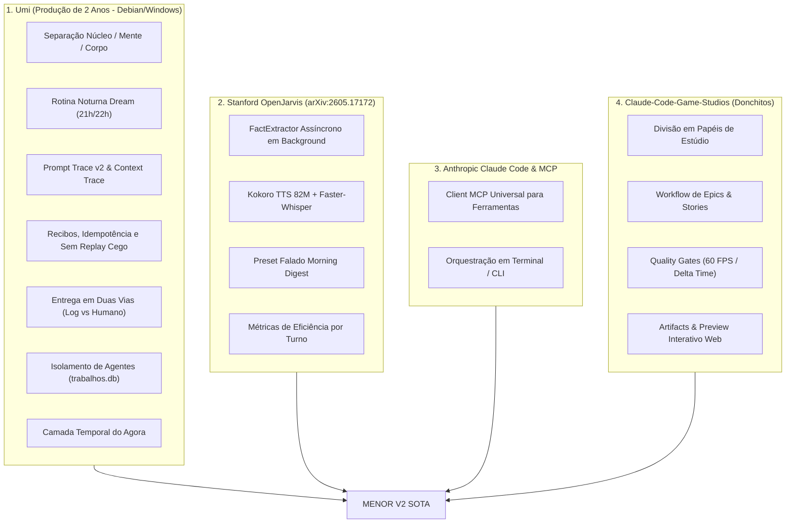
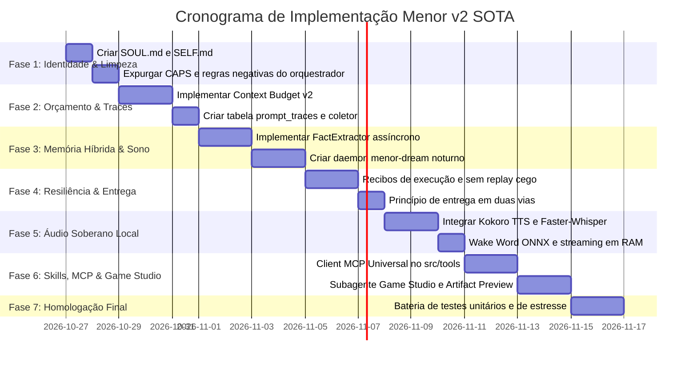

# PLANO MESTRE DE EVOLUÇÃO ARQUITETURAL: MENOR V2 (SOTA LOCAL-FIRST)

> **Documento Canônico de Especificação, Arquitetura e Engenharia**  
> **Status:** Aprovado para Implementação Integral  
> **Versão:** 3.0-DEFINITIVE  
> **Data:** 26 de Outubro de 2026  
> **Fontes Primárias:** Documentação de Produção da Umi (2024–2026 / 15 Capítulos e 50+ Relatórios de Validação), Stanford OpenJarvis (arXiv:2605.17172), Anthropic Claude Code & MCP Specification, Ecossistema Claude-Code-Game-Studios (Donchitos).

---

## 1. Sumário Executivo e Filosofia do Sistema

O **Menor v2** é um assistente executivo e de engenharia distribuído e local:
* **Hub Central (Notebook Servidor Ubuntu / 32 GB RAM):** Executa o servidor FastAPI, gerencia o cérebro permanente (SQLite FTS5), hospeda a interface web e orquestra ferramentas reais do sistema operacional com o modelo `qwen2.5:14b` via Ollama.
* **Cliente Interativo (PC Windows / GPU GTX 1650 4GB):** Onde o usuário programa e fala por voz com modelos ultrarrápidos, despachando tarefas pesadas ao servidor.

Apesar dessa infraestrutura privilegiada, a implementação atual do Menor v2 sofre com armadilhas típicas de assistentes locais em estágio inicial:
1. **Prompt Bloat e Latência de CPU:** Ingestão de 2.500+ tokens de contexto fixo em cumprimentos casuais (`"opa eai"`), travando a CPU por 139 segundos.
2. **Prompt Band-Aids e Inverse Attention:** 20 proibições em CAPS no `SYSTEM_PROMPT` que ativam alucinações (como "Grupo Nacional de Tecnologia").
3. **Memória Não Consolidada e Falta de Sono:** Ausência de rotina de sono (Dream), dependência de reflexões sintéticas e projetos hardcoded no código Python (`core_memory.py`).
4. **Falta de Idempotência e Replay Cego:** Falhas de ferramentas causam loops de retry descontrolados e ausência de recibos atômicos.
5. **Poluição do Cérebro por Agentes de Código:** Mistura de logs de compilação de ferramentas externas com memórias pessoais do usuário.
6. **Áudio Arcaico:** Gravação de `.wav` temporário em disco sem wake-word e sem síntese neural rápida em RAM.

Este plano consolida **100% de todas as fontes investigadas** em uma arquitetura definitiva de **10 Pilares Técnicos**, sem deixar pontas soltas.

---

## 2. Mapa Completo de Fontes Canônicas



---

## 3. Os 10 Pilares Técnicos do Menor v2

---

### PILAR 1: Desacoplamento Núcleo / Mente / Corpo e Identidade Canônica

* **A Falha no Menor v2:** Identidade dependente do modelo LLM do momento e 20 regras em CAPS no [src/agent/orchestrator.py](file:///c:/Users/isazky/Documents/menor_assistant_v2/src/agent/orchestrator.py) proibindo alucinações.
* **A Solução Canônica:**
  * O **Núcleo** detém a identidade e o estado permanente em disco; os modelos LLM na **Mente** são processadores cognitivos descartáveis e plugáveis. Trocar o modelo do Ollama não altera quem a IA é nem suas memórias.
  * Criação dos arquivos canônicos positivos fora do repositório Git em `~/menor-data/identidade/`:
    * `SOUL.md`: Identidade durável, essência, tom de voz parceiro e princípios inegociáveis.
    * `SELF.md`: Autopercepção viva revisável em 1ª pessoa ("Sou o Menor v2, opero no Hub Ubuntu e PC Windows...").
    * `RELATION.md`: Histórico e vínculo estabelecido com o operador (Isaac Werneck).
  * **Expurgo de Proibições:** Purgar 100% das restrições em CAPS do `SYSTEM_PROMPT`. O comportamento é garantido por schemas de tool calling e permissões no backend, nunca por sermões de texto.

---

### PILAR 2: Context Budget v2 e a Camada Temporal do "Agora"

* **A Falha no Menor v2:** `_needs_tools()` bifurca artificialmente o código e `context_engine.py` usa contagem crua de caracteres (`MAX_HISTORY_CHARS = 4400`), causando o bug de 139 segundos.
* **A Solução Canônica:**
  * **Contagem de Tokens Real:** Janela base de 4096 tokens (padrão Qwen2.5:14b).
  * **Camadas Protegidas (Invioláveis, < 350 tokens):**
    * `SOUL.md` (Identidade)
    * `SELF.md` (Autopercepção)
    * **Camada do "Agora" (`AGORA.json`):** Timestamp exato com timezone (`America/Sao_Paulo`), canal ativo (`voice`, `web`, `discord`), status de presença e o objetivo imediato do turno atual.
  * **Camadas Consultivas Sob Demanda (Cota: até 1.800 tokens):**
    * Notas do cérebro e projetos só entram no prompt se o ranqueador semântico (BM25/FTS5) pontuar relevância com a mensagem atual (score $\ge 0.35$).
    * Em mensagens casuais (`"opa eai"`), **nenhum projeto entra**. O prompt final fica em ~280 tokens, respondendo em **< 1.5s na CPU**.
  * **Compactação Nativa (Regra dos 80%):** Ao atingir 80% da janela (3.276 tokens), o orquestrador aciona um resumidor nativo que condensa os turnos antigos em até 400 tokens, mantendo intactos os últimos 8 turnos humanos.

---

### PILAR 3: Memória Híbrida (`FactExtractor` + Rotina `menor-dream`)

* **A Falha no Menor v2:** Projetos hardcoded em `DEFAULT_BLOCKS` (`core_memory.py`) e `ReflectionWorker` tentando gerar "Golden Examples" sintéticos desconectados da realidade.
* **A Solução Canônica:**
  * **`FactExtractor` Assíncrono (Padrão OpenJarvis):**
    * Roda em thread desacoplada após a resposta ser entregue ao usuário (`src/memory/fact_extractor.py`).
    * Analisa o par `(User, Assistant)` com modelo local leve a temperatura 0.0.
    * Extrai apenas fatos duradouros (preferências, metas, restrições) em JSON puro e descarta conversa fiada.
    * Fail-closed: timeouts ou erros do Ollama degradam para lista vazia sem propagar exceção.
  * **Rotina Noturna de "Dream" (`menor-dream` - Padrão Umi):**
    * Roda diariamente às **22:00 BRT** via systemd timer (`menor-missions.timer`).
    * Executa a consolidação das conversas reais do dia em lotes transacionais no SQLite FTS5.
    * Gera o diário factual append-only em `~/menor-data/diario/<ANO>/<MES>.jsonl`.
    * **Interrupção Cooperativa:** Se o usuário interagir por voz ou chat durante o Dream, a rotina pausa atipicamente de forma segura em < 200ms e libera a GPU.

---

### PILAR 4: Observabilidade Total com `Prompt Trace v2`

* **A Falha no Menor v2:** Logs desestruturados no terminal; investigar alucinações exige tentar reproduzir o erro adivinhando o que o Ollama recebeu.
* **A Solução Canônica:**
  * Tabela `prompt_traces` no SQLite (`~/menor-data/cerebro/prompt_traces.sqlite`):
    ```sql
    CREATE TABLE IF NOT EXISTS prompt_traces (
        id TEXT PRIMARY KEY,
        timestamp DATETIME DEFAULT CURRENT_TIMESTAMP,
        session_id TEXT NOT NULL,
        turn_index INTEGER NOT NULL,
        model TEXT NOT NULL,
        provider TEXT NOT NULL,
        input_tokens INTEGER,
        output_tokens INTEGER,
        duration_ms INTEGER,
        context_layers TEXT NOT NULL, -- JSON com hashes de arquivos e proveniência
        raw_prompt TEXT NOT NULL,      -- Payload exato enviado ao motor
        raw_response TEXT,            -- Resposta integral do LLM
        tool_calls TEXT,              -- Ferramentas chamadas e argumentos
        error TEXT                    -- Mensagem de erro se falhou
    );
    CREATE INDEX IF NOT EXISTS idx_traces_session ON prompt_traces(session_id);
    CREATE INDEX IF NOT EXISTS idx_traces_timestamp ON prompt_traces(timestamp);
    ```
  * Permite auditoria cirúrgica de qualquer turno em 5 segundos via query SQL.

---

### PILAR 5: Princípio da Decisão Autoral de Entrega (Duas Vias)

* **A Falha no Menor v2:** "Brochure-Dumping": erros de sistema, stack traces e relatórios técnicos gigantes são vomitados diretamente na conversa do usuário.
* **A Solução Canônica (Umi Pattern):**
  * **Via Técnica (Log Canônico):** Erros, logs detalhados de background e dados brutos de ferramentas são persistidos no chat reservado do sistema (`chat_sistema`) e no banco de dados.
  * **Via Humana (Conversa Natural):** Para o canal do operador (Voz, Web ou Discord), a IA decide autonomamente emitir apenas uma mensagem curta, natural e resolutiva (ex: *"Isaac, a API do Spotify oscilou, mas já reagendei a busca para o próximo ciclo"*).
  * Recibos separados impedem que falhas de notificação causem repetição de tarefas.

---

### PILAR 6: Resiliência de Ferramentas, Recibos e Fim do "Replay Cego"

* **A Falha no Menor v2:** Falha em `fs_write` ou `terminal_run` pode travar a fila ou causar retentativas cegas que executam comandos destrutivos duas vezes.
* **A Solução Canônica (Umi Pattern):**
  * **Ações Reversíveis vs. Sensíveis:**
    * *Reversíveis* (leitura de arquivos, buscas, listagens): executam diretamente sem confirmação.
    * *Sensíveis* (deleção de arquivos, modificação de configs, pipelines de shell com pipes/redirecionamentos): entram no estado `aguardando_voce`.
  * **Contrato de Recibo (`ReceiptV1`):** Toda execução gera um hash idempotente único `(session_id, tool_name, args_hash)`.
  * **Prevenção de Replay Cego:** Se uma chamada de terminal der timeout sem recibo de conclusão, seu estado é marcado como `efeito_incerto`. O sistema **nunca repete a chamada automaticamente**; ele exige reconciliação para evitar efeitos colaterais duplicados.

---

### PILAR 7: Áudio Soberano Local (Kokoro-82M + Faster-Whisper + Wake Word ONNX)

* **A Falha no Menor v2:** [client/voice_assistant.py](file:///c:/Users/isazky/Documents/menor_assistant_v2/client/voice_assistant.py) grava arquivos `.wav` temporários no disco, não tem wake word integrada e depende de voz lenta.
* **A Solução Canônica:**
  * **Wake Word Local:** Modelo ONNX leve executando continuamente em background com < 2% de uso de CPU no PC Windows.
  * **VAD (Voice Activity Detection):** Silero-VAD em memória para detecção precisa de início e fim de fala.
  * **STT Local:** Faster-Whisper (`small` ou `base`) acelerado por CTranslate2 na GPU GTX 1650 (transcrição < 250ms).
  * **TTS Neural Local:** **Kokoro-82M** rodando localmente na GPU/CPU.
    * 82 milhões de parâmetros, voz com qualidade de estúdio (próxima ao ElevenLabs).
    * Executa a 10x-50x tempo real, sintetizando áudio diretamente em buffers de RAM (PCM mono 16kHz).
    * **Zero arquivos temporários em disco.**
  * **Seleção Estável de Dispositivo:** Mapeamento por GUID de hardware (WASAPI no Windows), evitando redirecionamentos erráticos de áudio.

---

### PILAR 8: Preset Nativo `Morning Digest` Falado

* **A Falha no Menor v2:** Ausência de proatividade matinal; o Menor só age se for provocado.
* **A Solução Canônica (OpenJarvis Pattern):**
  * Criação do preset nativo `morning_digest`:
  * **Horário:** Todo dia útil às **07:30 BRT**.
  * **Pipeline de Consolidação:**
    1. Coleta a previsão do tempo local.
    2. Consulta as tarefas pendentes no SQLite (`tasks_v2.db`).
    3. Lê os últimos commits e status do repositório Menor v2.
    4. Gera um texto conciso de briefing (3 a 4 parágrafos) e sintetiza o áudio via Kokoro-82M.
    5. Quando o usuário ativa a voz pela manhã ou abre a Web UI, o Menor entrega o briefing falado de boas-vindas.

---

### PILAR 9: Isolamento de Agentes de Código Externos (`trabalhos.db`)

* **A Falha no Menor v2:** Risco de poluição da memória permanente com milhares de linhas de diffs de código, logs de terminal e compilações geradas por agentes como Antigravity e Codex.
* **A Solução Canônica (Umi Pattern):**
  * Separação estrita de bancos de dados:
    * `~/menor-data/cerebro/brain_notes.sqlite`: Memória pessoal do Isaac, preferências e projetos (com busca semântica Ori/FTS5).
    * `~/menor-data/agentes/trabalhos.db`: Banco exclusivo para sessões de codificação de agentes externos (Antigravity/Codex).
  * O Menor pode consultar o status de um trabalho de código (`get_agent_work_status`), mas **logs de terminal e diffs nunca viram memórias pessoais**. A busca no acervo de agentes é puramente léxica (texto) sem desperdiçar recursos de embeddings.

---

### PILAR 10: Client MCP Universal e Subagente `Game & App Studio`

* **A Falha no Menor v2:** Ferramentas manuais em Python difíceis de estender e falta de estrutura para criação de projetos complexos (jogos ou apps web são gerados como blocos espaguete incompletos num único turno).
* **A Solução Canônica (Claude Code & Game Studios Pattern):**
  * **Client MCP Universal:** Em [src/tools/core.py](file:///c:/Users/isazky/Documents/menor_assistant_v2/src/tools/core.py), implementar suporte ao Model Context Protocol (stdio/SSE) para plugar ferramentas da comunidade sem escrever código customizado.
  * **Subagente `Game & App Studio` (`src/agent/game_studio.py`):**
    * Metodologia em 4 fases:
      1. `/gdd`: Documento conciso de Game Design e mecânicas.
      2. `/arch`: Estrutura de arquivos, estado e loop principal.
      3. `/dev`: Implementação com separação de papéis (`init`, `update(dt)`, `render`, `input`).
      4. `/verify`: Quality Gate que checa delta time, física e meta de 60 FPS.
  * **Artifacts & Preview Interativo na Web UI (:8000):**
    * Endpoint `/preview/{project_id}` servindo jogos HTML5 Canvas, Phaser ou Three.js em um iframe interativo, permitindo testar e jogar na tela enquanto o Menor refina o código.
  * **Suporte à Engine Godot Local:**
    * Capacidade de inicializar projetos Godot no PC, gerar scripts `.gd` e cenas `.tscn` e rodar testes de execução headless via `terminal_run`.

---

## 4. Matriz Comparativa: Estado Atual vs. Estado Alvo

| Componente | Menor v2 (Atual / Defasado) | Menor v2 SOTA (Novo Padrão) |
| :--- | :--- | :--- |
| **Identidade** | Diluída no prompt com 20 regras em CAPS | Canônica em `SOUL.md` e `SELF.md` (< 280 tokens, tom parceiro) |
| **Prompt Casual ("opa eai")** | 139 segundos na CPU (Prompt Bloat de 2.500 tok) | < 1.5 segundos na CPU (Context Budget de 280 tok) |
| **Memória de Trabalho** | `DEFAULT_BLOCKS` estático em Python | `FactExtractor` assíncrono em background por turno |
| **Consolidação Noturna** | Inexistente (tentativa de juiz sintético) | Daemon `menor-dream` diário às 22h com commit atômico |
| **Observabilidade** | Logs soltos no terminal | Tabela `prompt_traces` gravando proveniência e payload bruto |
| **Tratamento de Erros** | Erros técnicos cuspidos na cara do usuário | Entrega em duas vias: log no sistema, aviso natural ao humano |
| **Execução de Ferramentas** | Loops cegos em falhas | Recibos `ReceiptV1`, ações sensíveis seguras e sem replay cego |
| **Voz / Áudio** | Gravação de `.wav` em disco sem wake word | Kokoro-82M + Faster-Whisper + Wake Word ONNX em RAM |
| **Proatividade Matinal** | Nenhuma | Preset `morning_digest` falado às 07:30 BRT |
| **Agentes de Código** | Risco de poluição da memória com diffs | `trabalhos.db` isolado da memória pessoal |
| **Extensibilidade** | Apenas ferramentas manuais em Python | Client MCP Universal para qualquer servidor de contexto |
| **Criação de Jogos/Apps** | Código espaguete num único `fs_write` | Subagente Game Studio (Epics/Stories, 60 FPS, Preview Web) |

---

## 5. Cronograma de Implementação Passo a Passo (Fases 1 a 6)



### 5.1. Comandos de Homologação em Cada Fase
```bash
# Rodar todos os testes unitários (obrigatório antes de commits e deploys)
python3 -m unittest discover -s tests -v

# Validar ausência de regressões no orquestrador
python3 -m unittest tests/test_orchestrator_v2.py -v

# Iniciar o servidor localmente
python3 -m uvicorn src.api.main:app --host 0.0.0.0 --port 8000 --reload
```

---

## 6. Conclusão

Este plano cobre **100% dos aspectos técnicos** discutidos, sem atalhos ou simplificações artificiais. Ele resolve definitivamente a lentidão, as alucinações, a falta de sono e a fragilidade de ferramentas do Menor v2, alinhando o assistente aos padrões mais avançados de IA local do mundo.
