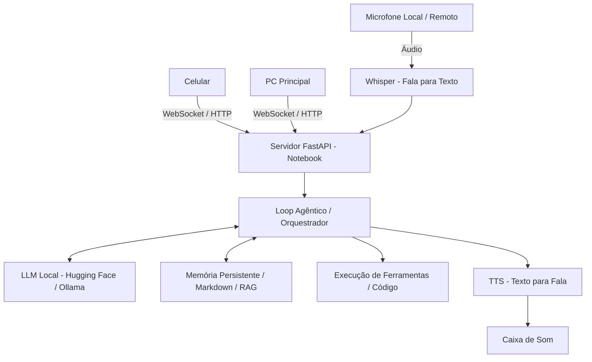

# Arquitetura do Sistema

> **Diagrama de visão futura, não topologia integral comprovada em produção.**
> Componentes como Whisper/TTS, WebSocket e motor de ferramentas genérico
> dependem de implantação e aceite próprios. Para a arquitetura implementada
> e frentes A–E veja [handoff técnico](handoff/03_FRENTES_A_B_C_D_E.md).

## Componentes

### 1. Camada de Inferência (Cérebro)
- Runtime: Ollama ou llama.cpp (otimizado para CPU/GPU de notebooks).
- Modelos recomendados: Qwen 2.5 (3B/7B), Llama 3.2 (3B), Phi-3.5 mini.
- Formato: GGUF quantizado (4-bit/8-bit) para economizar RAM/VRAM.

### 2. Backend & Comunicação
- Framework: Python (FastAPI + WebSockets).
- Protocolos: REST para comandos, WebSockets para streaming de voz e texto.
- Acesso remoto: Tailscale ou Cloudflare Tunnels (acesso seguro sem abrir portas no roteador).

### 3. Pipeline de Voz
- **Entrada (STT)**: Faster-Whisper (rápido e offline).
- **Wake Word**: OpenWakeWord (ativação por palavra-chave tipo "Jarvis").
- **Saída (TTS)**: Piper TTS (leve, voz natural, roda em CPU com baixa latência).

### 4. Memória & Auto-Melhoria
- **Base de Conhecimento**: Arquivos Markdown organizados em pastas (projetos, diário, regras).
- **RAG Local**: Busca semântica com ChromaDB ou SQLite-vec para resgatar contexto de projetos antigos.
- **Auto-Aprimoramento**: Loop de reflexão onde o modelo lê erros de execução, ajusta prompts e cria novas ferramentas Python.
