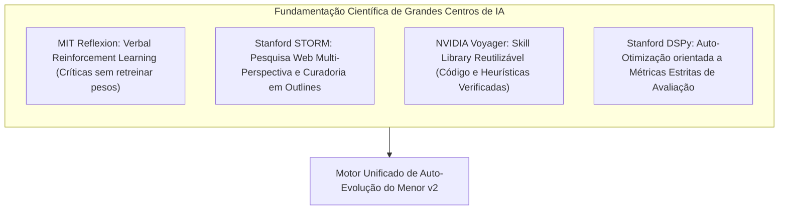
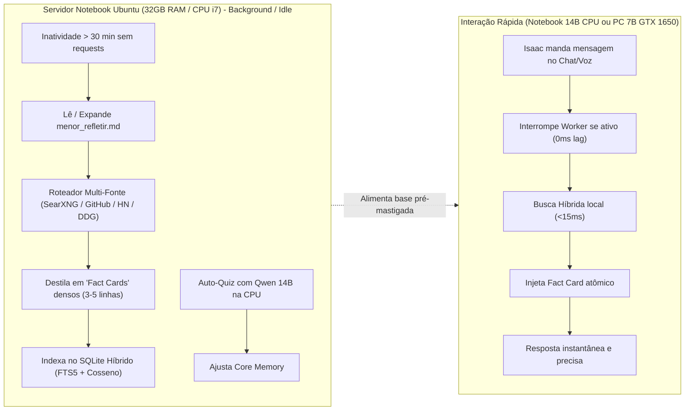
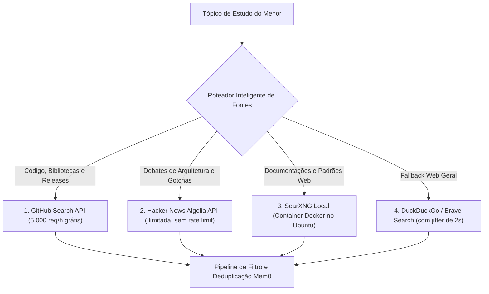
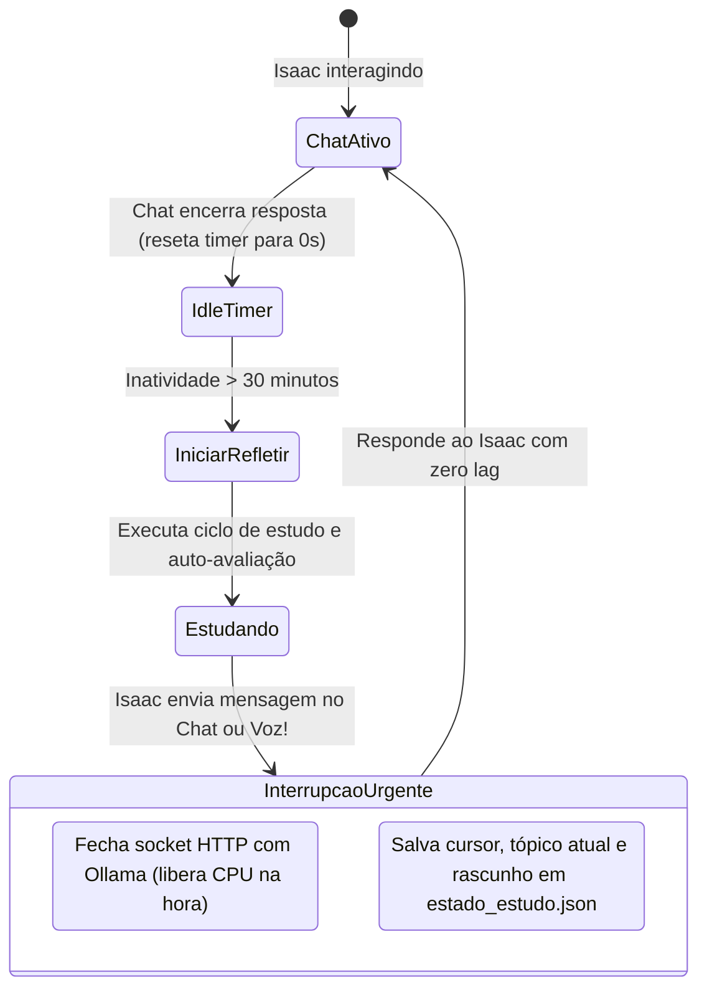
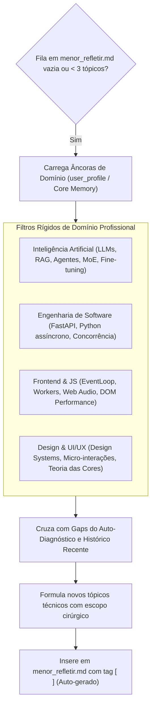
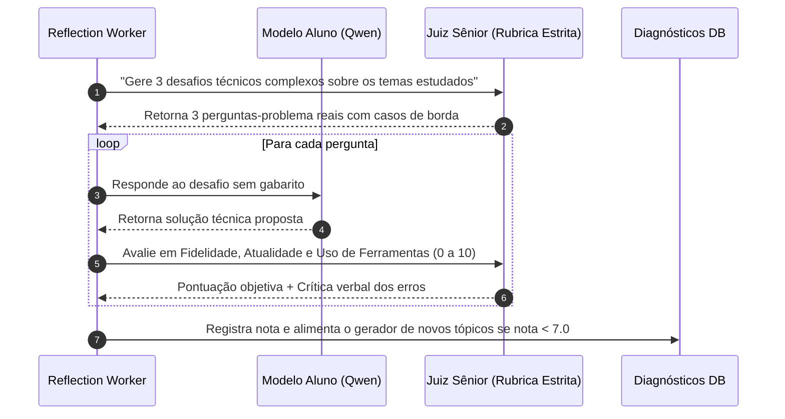

# Plano de Engenharia: Sistema de Auto-Evolução, Pesquisa Autônoma e Auto-Diagnóstico do Menor v2

Este documento estabelece o plano arquitetural completo para transformar o Menor v2 em um assistente cognitivo **auto-evolutivo**, capaz de estudar ativamente em momentos de inatividade, autodiagnosticar suas fraquezas técnicas, gerar novos tópicos de estudo alinhados ao perfil do operador e receber comandos de estudo diretamente por chat ou voz.

---

## 1. Fundamentação Científica: O Estado da Arte em Agentes Autônomos

Para construir um sistema viável, robusto e sem alucinações em hardware local, combinamos 4 arquiteturas consagradas na literatura recente de IA:



| Arquitetura | Instituição | Mecanismo Central | Aplicação no Menor v2 |
| :--- | :--- | :--- | :--- |
| **Reflexion** | MIT / Northeastern | *Verbal Reinforcement Learning*: gera críticas linguísticas dos erros cometidos e as salva em buffer episódico. | O Menor avalia suas respostas em testes sintéticos, descobre falhas conceituais e ajusta regras na Core Memory. |
| **STORM** | Stanford OVAL | *Multi-perspective Information Seeking*: simula múltiplos ângulos de pesquisa antes de consolidar o conhecimento. | O agente divide cada tópico em subperguntas técnicas (APIs oficiais, discussões reais e armadilhas comuns). |
| **Voyager** | NVIDIA / Stanford | *Skill Library*: armazena procedimentos e códigos executáveis em base vetorial, eliminando o esquecimento catastrófico. | Quando o Menor descobre um padrão de código ou solução de bug, salva um snippet verificado para reuso imediato. |
| **DSPy** | Stanford NLP | *Automated Metric Optimization*: testes com pontuações estruturadas (0 a 10) em vez de impressões subjetivas. | Avaliação sintética rigorosa das respostas do Menor para detectar código quebrado, obsolescência e superficialidade. |

---

## 2. Topologia de Hardware e Desacoplamento Temporal

O sistema foi desenhado estritamente para o ambiente de duas máquinas do Isaac, garantindo **máxima velocidade** no dia a dia:



### Princípios de Performance:
1. **Poupando a CPU do Notebook (i7 / 32GB RAM):** O modelo `qwen2.5:14b` roda 100% na CPU. O estudo e a síntese ocorrem de forma assíncrona, pré-mastigando os dados para que o chat não gaste CPU processando páginas web pesadas.
2. **Respeitando os 4GB de VRAM da GTX 1650 (PC Windows / Futuro 7B):** Os *Fact Cards* de 3 a 5 linhas evitam que o prompt estoure a VRAM da placa de vídeo.
3. **Zero Espera de Rede no Chat:** Perguntas sobre temas estudados batem direto no SQLite FTS5 local em milissegundos.

---

## 3. Roteador de Pesquisa Multi-Fonte (Fim do Bloqueio de IP)

Para permitir o estudo de **10 a 30+ tópicos por sessão** sem risco de bloqueio de IP (HTTP 429 / Captcha):



* **Por que essa combinação é imbatível:**
  - **Hacker News (Algolia API):** 100% aberta, sem autenticação, sem captcha e reúne as maiores discussões de engenharia de software do mundo.
  - **GitHub API:** Fornece código real, issues com resoluções de bugs e arquivos `README.md` direto em JSON estruturado.
  - **SearXNG Local:** Agrega múltiplos motores sem expor padrões de bot, eliminando o bloqueio de scraping de HTML.
  - **Jitter Defensivo:** Intervalos de 1 a 2 segundos entre chamadas garantem que nenhuma fonte sinta sobrecarga.

---

## 4. Inatividade de 30 Minutos, Preempção e Checkpoint Durável

O Menor estuda quando ninguém está usando, mas prioriza o operador imediatamente se chamado:



### Detalhes de Engenharia da Preempção:
* **Liberação Imediata de CPU:** Ao receber uma requisição em `/chat` ou `/chat/stream`, o servidor cancela a requisição ativa de background. O Ollama detecta o socket fechado e interrompe a geração na CPU instantaneamente.
* **Arquivo de Estado (`~/menor-data/cerebro/estado_estudo.json`):**
  - Registra o tópico em andamento, sub-etapa atual, fontes já processadas e resumos parciais.
  - Ao retomar após nova inatividade de 30 minutos, o Menor continua exatamente de onde parou sem recomeçar do zero.

---

## 5. Motor de Curiosidade e Auto-Geração de Tópicos

Quando a fila de estudos esvaziar ou se nenhum tópico foi fornecido, o Menor não fica ocioso: ele **cria seus próprios tópicos de estudo**, mantendo o foco estrito no trabalho do Isaac.



### Como ele "adivinha" o que estudar sem alucinar assuntos aleatórios:
1. **Âncoras de Interesse Primárias (`identidade/core_memory.json`):**
   - O Menor possui gravado em seu perfil permanente os domínios do Isaac: *IA, Engenharia de Software, JavaScript, UI/UX, Design e Teoria das Cores*.
   - Qualquer tópico fora desses eixos (ex: culinária, amenidades) é bloqueado por uma checagem de pertinência no prompt de geração de tópicos.
2. **Expansão em Grafo (Próximo Passo Lógico):**
   - Se ele acabou de estudar *WebSockets no FastAPI*, a expansão natural sugere *Redis Pub/Sub para escala horizontal* ou *Server-Sent Events vs WebSockets*.
3. **Alimentação por Gaps de Auto-Diagnóstico:**
   - Se o auto-teste apontou que ele hesitou em uma questão de acessibilidade CSS ou concorrência assíncrona, essa fraqueza vira automaticamente o próximo tópico prioritário de estudo.

---

## 6. Agendamento Conversacional por Chat e Voz (`schedule_study_topic`)

O Isaac não precisa editar arquivos Markdown manualmente. Basta pedir naturalmente:

> *"Aí, mano, tem como tu estudar Server-Sent Events e Web Audio API quando você for refletir?"*
> *"Aí mano, hoje à noite quero que você pesquise as novidades do Qwen 2.5 Coder."*

### Mecanismo de Execução:
* **Ferramenta Nativa `schedule_study_topic`:**
  - Registrada no catálogo de ferramentas do Menor ([`src/tools/core.py`](file:///c:/Users/isazky/Documents/menor_assistant_v2/src/tools/core.py)).
  - Parâmetros: `topic` (título claro), `category` (ia, software, frontend, design), `priority` (high/normal), `user_note` (instrução adicional).
* **Fluxo:**
  1. O modelo detecta o comando coloquial e aciona `schedule_study_topic(...)`.
  2. A ferramenta anexa a linha no topo de `~/menor-data/cerebro/menor_refletir.md`:
     ```markdown
     - [ ] [Alta Prioridade] Server-Sent Events e Web Audio API (Adicionado pelo Isaac em 2026-10-24)
     ```
  3. O Menor confirma de forma natural e amigável:
     > *"Fechado, mano! Já anotei aqui no meu plano de estudos. Assim que o sistema ficar 30 minutos tranquilo ou na reflexão de hoje à noite, eu caio de cabeça nesse tema e preparo as fichas técnicas pra gente."*

---

## 7. Auto-Diagnóstico Sintético (LLM-as-a-Judge)



* **Rubrica de Notas Objetivas:**
  - **Fidelidade e Sintaxe (0-10):** O código é real e funcional?
  - **Atualidade (0-10):** O conceito corresponde ao estado da arte em 2026 ou a práticas legadas?
  - **Consciência de Ferramentas (0-10):** O modelo identificou quando precisava inspecionar o sistema em vez de adivinhar?
  - **Concisão Sênior (0-10):** Direto ao ponto, sem preâmbulos genéricos.

---

## 8. Estrutura de Arquivos e Armazenamento

Todos os dados mutáveis permanecem sob `~/menor-data/cerebro/`, fora do repositório Git:

```text
~/menor-data/cerebro/
├── menor_refletir.md                  <-- Tópicos de estudo (editáveis pelo Isaac, por voz ou auto-gerados)
├── estado_estudo.json                 <-- Checkpoint durável para pausar/retomar sem perda
├── identidade/
│   ├── core_memory.json               <-- Memória viva e âncoras de interesse
│   └── perfil_usuario.md
├── conhecimentos/
│   ├── aprendizados_gerais.md         <-- Fatos técnicos consolidados
│   ├── ia/
│   ├── software/
│   ├── javascript/
│   └── design_ux/
├── diagnosticos/
│   ├── auto_avaliacao_YYYYMMDD.md     <-- Boletins de auto-diagnóstico
│   └── historico_scores.sqlite        <-- Evolução temporal de acertos
└── indice.sqlite                      <-- FTS5 + Vetores com similaridade cosseno
```

---

## 9. Roteiro de Implementação em Fases

### Fase 1: Roteador de Pesquisa Multi-Fonte e Ferramenta de Agendamento
- Implementar clientes de busca leves: Hacker News API (Algolia) + GitHub Search API + DuckDuckGo fallback com jitter.
- Criar a ferramenta nativa `schedule_study_topic` no catálogo de ferramentas do Menor para comandos coloquiais no chat.
- Criar o parser e manipulador de `menor_refletir.md`.

### Fase 2: Idle Detector (30 min) e Preempção com Checkpoint
- Implementar o monitor de inatividade de 30 minutos em background no FastAPI.
- Adicionar a interrupção atômica do Ollama ao receber requisição em `/chat`.
- Implementar a serialização e restauração do checkpoint em `estado_estudo.json`.

### Fase 3: Motor de Curiosidade e Expansão de Tópicos
- Implementar a lógica de geração autônoma de tópicos baseada nas âncoras de domínio do Isaac quando a lista estiver vazia.
- Adicionar o filtro de relevância profissional para barrar temas fora do escopo de trabalho.

### Fase 4: Auto-Diagnóstico Sintético e Auto-Aprimoramento
- Desenvolver o gerador de desafios e o avaliador *LLM-as-a-Judge* com saída JSON estruturada.
- Conectar a nota $< 7.0$ à criação automática de novos tópicos de reforço e atualização de diretrizes na Core Memory.
- Adicionar os comandos de terminal unificados (`menor estudar`, `menor diagnosticar`, `menor refletir`).
